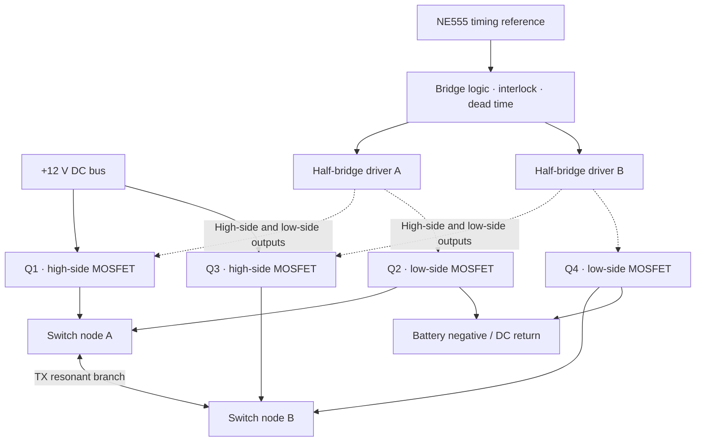

# Full H-Bridge Topology

| Bridge state | Q1 | Q2 | Q3 | Q4 |
|---|---|---|---|---|
| Positive | ON | OFF | OFF | ON |
| Dead time | OFF | OFF | OFF | OFF |
| Negative | OFF | ON | ON | OFF |
| Dead time | OFF | OFF | OFF | OFF |

The two MOSFETs in the same leg must never be commanded ON simultaneously.
