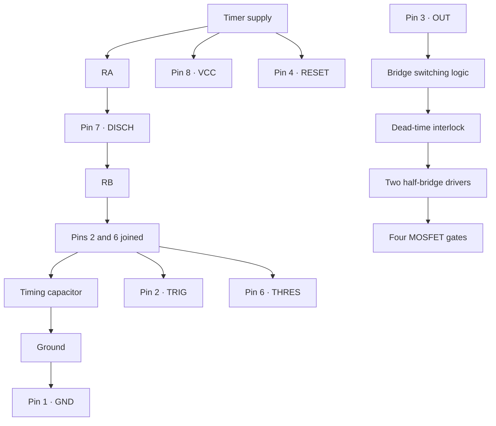

# NE555 Timing and Bridge Control

Astable timing equations:

- tH = 0.693 × (RA + RB) × C
- tL = 0.693 × RB × C
- f = 1.44 ÷ [(RA + 2RB) × C]

The NE555 output is a clock/reference, not four independent gate signals. The exact relationship between timer frequency and bridge frequency depends on the logic between the timer and gate drivers.
